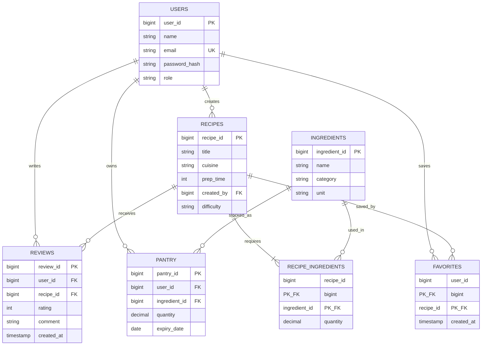
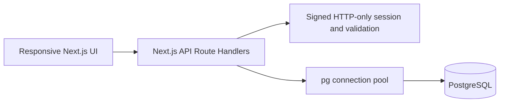

# Savor: Recipe & Pantry Manager

**DBMS Level 3 Project — SQL and web application components**
Prepared to match the supplied project guide, including both the SQL (PostgreSQL) and NoSQL (MongoDB) components.

## 1. Problem statement

Households often forget ingredients they already own, miss expiry dates, and choose recipes that require extra shopping. Savor stores pantry lots and recipe requirements in a relational database, then helps users find feasible meals and records their feedback.

## 2. Objectives and scope

- Design a normalized PostgreSQL database for accounts, ingredients, recipes, recipe quantities, pantry inventory, favorites, and reviews.
- Build a responsive browser interface connected through Next.js API routes.
- Demonstrate registration, role-based access, validated data operations, joins, aggregates, search, a view, a trigger, a stored function, and transactional stock deduction.
- Track expiry by pantry lot and deduct stock from the earliest-expiring available lots.
- Scope includes relational SQL and the web frontend. No MongoDB, document store, or vector database is implemented.

## 3. Functional requirements

1. Visitors can register and sign in; registration always assigns the student role.
2. Signed-in users can browse/search recipes and filter by cuisine/text and pantry feasibility.
3. Users can add pantry stock and optional expiry dates and remove their own stock entries.
4. Users can favorite recipes and submit/update one rating and comment per recipe.
5. Users can create recipes and edit/delete their own recipes.
6. Cooking a recipe subtracts all quantities atomically from unexpired lots in expiry order.
7. Administrators can extend the shared ingredient catalog; students cannot.

## 4. ER diagram



One user creates many recipes and owns many pantry lots. Recipes and ingredients are many-to-many through `recipe_ingredients`. Users and recipes are many-to-many through `favorites`. Reviews connect a user to a recipe, with one review per pair.

## 5. Relational schema

- `USERS(**user_id**, name, email UNIQUE, password_hash, role, created_at)`
- `INGREDIENTS(**ingredient_id**, name, category, unit, UNIQUE(name, category, unit))`
- `RECIPES(**recipe_id**, title, description, cuisine, prep_time, created_by FK → USERS.user_id, created_at, difficulty)`
- `RECIPE_INGREDIENTS(**recipe_id** FK → RECIPES.recipe_id, **ingredient_id** FK → INGREDIENTS.ingredient_id, quantity); PK(recipe_id, ingredient_id)`
- `PANTRY(**pantry_id**, user_id FK → USERS.user_id, ingredient_id FK → INGREDIENTS.ingredient_id, quantity, expiry_date, updated_at, UNIQUE(user_id, ingredient_id, expiry_date))`
- `FAVORITES(**user_id** FK → USERS.user_id, **recipe_id** FK → RECIPES.recipe_id, created_at); PK(user_id, recipe_id)`
- `REVIEWS(**review_id**, user_id FK → USERS.user_id, recipe_id FK → RECIPES.recipe_id, rating, comment, created_at, updated_at, UNIQUE(user_id, recipe_id))`

Bold columns are primary keys. Foreign-key delete behavior is declared in `db/schema.sql`.

## 6. Complete table and attribute dictionary

All key, nullability, default, and value rules below match `db/schema.sql`.

### USERS — accounts and roles

| Attribute | SQL type | Key / constraints | Purpose |
|---|---|---|---|
| user_id | BIGINT identity | PK | Unique account identifier |
| name | VARCHAR(120) | NOT NULL | Display name |
| email | VARCHAR(254) | NOT NULL, UNIQUE; must contain @ | Sign-in identifier |
| password_hash | TEXT | NOT NULL | Bcrypt hash; plaintext password is never stored |
| role | VARCHAR(20) | NOT NULL, DEFAULT 'student', CHECK student/admin | Authorization role; public registration assigns student |
| created_at | TIMESTAMPTZ | NOT NULL, DEFAULT current timestamp | Account creation time |

### INGREDIENTS — shared ingredient catalogue

| Attribute | SQL type | Key / constraints | Purpose |
|---|---|---|---|
| ingredient_id | BIGINT identity | PK | Unique ingredient identifier |
| name | VARCHAR(120) | NOT NULL | Ingredient name |
| category | VARCHAR(40) | NOT NULL, CHECK veg/fruit/spice/dairy/grain/protein/oil/other | Grouping used in the catalogue |
| unit | VARCHAR(30) | NOT NULL | Measurement unit, such as g, ml, piece, clove, or tsp |
| (name, category, unit) | — | UNIQUE composite | Prevents duplicate catalogue definitions |

### RECIPES — recipe details

| Attribute | SQL type | Key / constraints | Purpose |
|---|---|---|---|
| recipe_id | BIGINT identity | PK | Unique recipe identifier |
| title | VARCHAR(180) | NOT NULL | Recipe title |
| description | TEXT | NOT NULL, DEFAULT empty string | Short recipe description |
| cuisine | VARCHAR(80) | NOT NULL | Cuisine label used for discovery |
| prep_time | INTEGER | NOT NULL, CHECK > 0 | Preparation time in minutes |
| created_by | BIGINT | NOT NULL, FK → USERS.user_id, ON DELETE RESTRICT | Recipe owner; protects recipes from accidental account deletion |
| created_at | TIMESTAMPTZ | NOT NULL, DEFAULT current timestamp | Creation time |
| difficulty | VARCHAR(12) | NOT NULL, DEFAULT medium, CHECK easy/medium/hard | Recipe difficulty |
| (title, created_by) | — | UNIQUE composite | Prevents one user from creating duplicate titles |

### RECIPE_INGREDIENTS — recipe-to-ingredient junction

| Attribute | SQL type | Key / constraints | Purpose |
|---|---|---|---|
| recipe_id | BIGINT | PK part; FK → RECIPES.recipe_id, ON DELETE CASCADE | Recipe requiring the ingredient |
| ingredient_id | BIGINT | PK part; FK → INGREDIENTS.ingredient_id, ON DELETE RESTRICT | Required catalogue ingredient |
| quantity | NUMERIC(10,2) | NOT NULL, CHECK > 0 | Amount required, in the ingredient's catalogue unit |
| (recipe_id, ingredient_id) | — | Composite PK | One requirement row per ingredient in a recipe |

### PANTRY — user-owned stock lots

| Attribute | SQL type | Key / constraints | Purpose |
|---|---|---|---|
| pantry_id | BIGINT identity | PK | Unique stock-lot identifier |
| user_id | BIGINT | NOT NULL, FK → USERS.user_id, ON DELETE CASCADE | Owner of the stock |
| ingredient_id | BIGINT | NOT NULL, FK → INGREDIENTS.ingredient_id, ON DELETE RESTRICT | Stocked ingredient |
| quantity | NUMERIC(10,2) | NOT NULL, CHECK >= 0 | Remaining stock in the catalogue unit |
| expiry_date | DATE | Nullable | Lot expiration date; NULL means unknown/not supplied |
| updated_at | TIMESTAMPTZ | NOT NULL, DEFAULT current timestamp | Last stock-change time |
| (user_id, ingredient_id, expiry_date) | — | UNIQUE composite | Prevents duplicate lots with the same date for one user/item |

### FAVORITES — saved recipes junction

| Attribute | SQL type | Key / constraints | Purpose |
|---|---|---|---|
| user_id | BIGINT | PK part; FK → USERS.user_id, ON DELETE CASCADE | User who saved the recipe |
| recipe_id | BIGINT | PK part; FK → RECIPES.recipe_id, ON DELETE CASCADE | Saved recipe |
| created_at | TIMESTAMPTZ | NOT NULL, DEFAULT current timestamp | When it was saved |
| (user_id, recipe_id) | — | Composite PK | Prevents duplicate favorites |

### REVIEWS — ratings and comments

| Attribute | SQL type | Key / constraints | Purpose |
|---|---|---|---|
| review_id | BIGINT identity | PK | Unique review identifier |
| user_id | BIGINT | NOT NULL, FK → USERS.user_id, ON DELETE CASCADE | Reviewer |
| recipe_id | BIGINT | NOT NULL, FK → RECIPES.recipe_id, ON DELETE CASCADE | Reviewed recipe |
| rating | SMALLINT | NOT NULL, CHECK 1 through 5 | Star rating |
| comment | TEXT | NOT NULL, DEFAULT empty string | Review text |
| created_at | TIMESTAMPTZ | NOT NULL, DEFAULT current timestamp | Original submission time |
| updated_at | TIMESTAMPTZ | NOT NULL, DEFAULT current timestamp; trigger refreshed on update | Last edit time |
| (user_id, recipe_id) | — | UNIQUE composite | One editable review per user and recipe |

### Relationships and referential behavior

| Parent → child | Cardinality | Delete behavior / purpose |
|---|---|---|
| USERS → RECIPES | One-to-many | RESTRICT: keeps recipe ownership valid |
| RECIPES → RECIPE_INGREDIENTS | One-to-many | CASCADE: delete dependent ingredient requirements with recipe |
| INGREDIENTS → RECIPE_INGREDIENTS | One-to-many | RESTRICT: used ingredients cannot be removed while referenced |
| USERS → PANTRY | One-to-many | CASCADE: remove user's private stock with account |
| INGREDIENTS → PANTRY | One-to-many | RESTRICT: preserve stock's ingredient reference |
| USERS ↔ RECIPES through FAVORITES | Many-to-many | Both foreign keys cascade; pair is unique |
| USERS ↔ RECIPES through REVIEWS | Many-to-many | Both foreign keys cascade; pair is unique |

## 7. Database choice and architecture

PostgreSQL fits the relational links and integrity rules. It also provides transactions, full-text search, views, triggers, and stored functions. A Next.js client calls API route handlers; handlers validate input, authenticate and authorize, then issue parameterized SQL through a PostgreSQL connection pool.



## 8. Frontend design and behavior

The frontend is a responsive Next.js App Router application with a desktop side navigation and compact mobile navigation. The interface uses simple recipe cards, small CSS illustrations, short forms, and clear empty states. It is designed to make the project database operations easy to demonstrate.

| Screen / component | What the user sees | Main actions and database operations |
|---|---|---|
| Welcome and account dialog | Sign-in or registration fields | Register a student or authenticate; bcrypt and signed session cookie are handled server-side |
| Discover | Recipe cards with cuisine, time, difficulty, author, rating, and review count | Search; filter pantry-makeable recipes; review; favorite; cook; create a recipe |
| My pantry | Ingredient list, quantity/unit, expiry date, and summary counts | Add stock with optional expiry; remove own stock; user-scoped records |
| Favorites | Recipes saved by the current user | Toggle saved state using the favorites composite key |
| Recipe creation dialog | Title, description, cuisine, prep time, difficulty, and repeatable ingredient/quantity rows | Create recipe and junction rows in one transaction |
| Review dialog | Rating from 1 to 5 and comment | Insert or update one review per user/recipe pair |
| Account dialog | Current name, email, and role | Sign out and clear the session cookie |

Recipe cards use CSS illustrations; no image uploads are required. Empty states guide users to add stock, save a recipe, or create a recipe. Validation and success messages appear as short notifications. The student interface does not include an ingredient administration form. Administrators can add catalogue items through the protected `POST /api/ingredients` route.

### Frontend API route map

| Route | Methods | Purpose / authorization |
|---|---|---|
| `/api/auth/register` | POST | Validate input, hash password, create student account, set session |
| `/api/auth/login` | POST | Verify password and issue signed HTTP-only session |
| `/api/auth/logout` | POST | Clear session cookie |
| `/api/auth/me` | GET | Return current identity |
| `/api/recipes` | GET, POST | Search/filter recipes; create recipe and ingredient rows transactionally |
| `/api/recipes/:id` | GET, PUT, DELETE | Read/manage recipe; owner or admin checks |
| `/api/recipes/:id/reviews` | POST | Upsert signed-in user's rating/comment |
| `/api/recipes/:id/cook` | POST | Deduct stock across unexpired lots; commit or roll back |
| `/api/pantry` | GET, POST | List or add current user's pantry lots |
| `/api/pantry/:id` | PATCH, DELETE | Update/delete only a lot belonging to current user |
| `/api/favorites` | GET | List current user's favorites |
| `/api/favorites/:recipeId` | POST | Add/remove favorite |
| `/api/ingredients` | GET, POST | Admin-only catalogue list/add endpoint |

### Seeded demonstration data

The repeatable seed adds one student and one admin, nine shared ingredients, three recipes, recipe ingredient requirements, nine dated pantry items, one favorite, and one review. The sample dishes are Tomato Cumin Rice, Golden Lentil Bowl, and Coriander Yogurt Dip. Stock supports pantry matching and cooking demonstrations. Local demo credentials are documented in the README.

## 9. SQL implementation and advanced concepts

`db/schema.sql` contains DDL, constraints, indexes, full-text GIN indexing, `ALTER TABLE`, and rerunnable trigger DDL. Advanced concepts include the reporting view `recipe_rating_summary`, trigger `reviews_set_updated_at`, stored function `find_makeable_recipes(user_id)`, full-text recipe search, and transactional stock consumption.

Example reporting query (JOIN, aggregate, GROUP BY, HAVING, ORDER BY):

```sql
SELECT r.title, COUNT(rv.review_id) AS reviews,
       ROUND(AVG(rv.rating)::numeric, 2) AS average_rating
FROM recipes r LEFT JOIN reviews rv ON rv.recipe_id = r.recipe_id
GROUP BY r.recipe_id, r.title
HAVING COUNT(rv.review_id) >= 0
ORDER BY average_rating DESC NULLS LAST, r.title;
```

Example subquery for pantry-feasible recipes:

```sql
SELECT r.title FROM recipes r
WHERE NOT EXISTS (
  SELECT 1 FROM recipe_ingredients ri
  WHERE ri.recipe_id = r.recipe_id AND NOT EXISTS (
    SELECT 1 FROM pantry p
    WHERE p.user_id = $1 AND p.ingredient_id = ri.ingredient_id
      AND p.quantity >= ri.quantity
      AND (p.expiry_date IS NULL OR p.expiry_date >= CURRENT_DATE)
  )
);
```

## 10. Security and validation

Passwords use bcrypt. Session data is signed in an HTTP-only cookie. Registration cannot choose an admin role. API writes validate data on the server and use bound SQL parameters. Pantry operations filter by session user; recipe modifications require ownership or admin access; ingredient creation is admin-only. Same-origin checks guard writes. Cooking locks stock rows and commits only if every quantity is available, otherwise it rolls back.

## 11. Test plan and status

| Check | Expected result | How to run |
|---|---|---|
| Schema/seed checks | Relations, keys, constraints, SQL features present | `npm test` |
| ESLint | No lint errors | `npm run lint` |
| Production compile | Next.js app compiles | `npm run build` |
| Registration | Student created with bcrypt hash; duplicate email rejected | UI/API |
| Role authorization | Student ingredient creation returns 403 | `POST /api/ingredients` |
| Pantry ownership | Other user's stock cannot be edited/deleted | PATCH/DELETE returns 404 |
| Stock transaction | Stock deducted or all changes rolled back | Cook recipe in UI; inspect pantry |
| Review uniqueness | Repeat submission updates the existing review | Submit second rating |

**Local execution status:** PostgreSQL schema setup and demo seeding completed successfully. The database contains 3 recipes, 9 ingredients, and 9 pantry lots. The demo student sign-in succeeded, the home page returned HTTP 200, and the schema/seed test suite passed 3 of 3 checks. The production build and full lint command have not been confirmed in this environment.

## 12. Demonstration plan

Start PostgreSQL and the app as described in the README. Sign in as the demo student. Search recipes, filter by pantry match, add pantry stock, show expiry dates, favorite a recipe, submit a rating, and cook a recipe while showing quantities decrease. Create a recipe. Sign in as admin and show ingredient creation. Finish with the schema and explain the ERD, keys, constraints, indexes, view, trigger, stored function, and transaction.


## 14. NoSQL component — MongoDB cooking logs

### Justification

Relational tables are ideal for pantry quantities, recipe–ingredient requirements, and referential integrity. Cooking *sessions*, however, carry highly variable attributes: free-form notes, optional substitutions, cook-specific ratings, time taken, tags, and lists of ingredients actually used. These fit a document model better than a rigid relational schema. MongoDB is therefore used for an append-only `cooking_logs` collection while PostgreSQL remains the system of record for structured inventory and recipes.

### Data model

```
cooking_logs {
  _id: ObjectId
  userId: Number          // logical FK → users.user_id
  recipeId: Number        // logical FK → recipes.recipe_id
  recipeTitle: String     // denormalized for display
  cuisine: String
  cookedAt: Date
  notes?: String
  substitutions?: [{ original: String, used: String }]
  ratingOfCook?: Number   // 1–5
  timeTakenMinutes?: Number
  servings?: Number
  success: Boolean
  ingredientsUsed?: [{ name, quantity, unit }]
  tags?: [String]
  metadata?: Object
}
```

### Indexes

- `{ userId: 1, cookedAt: -1 }` — primary user history query
- `{ recipeId: 1 }`
- `{ cuisine: 1 }`
- Text index on `notes`, `recipeTitle`, `tags`
- `{ cookedAt: -1 }`

### Integration points

1. **POST /api/recipes/:id/cook** — after a successful SQL transaction that deducts pantry stock, a cooking_log document is inserted into MongoDB (notes and optional fields may be supplied in the request body).
2. **GET /api/cooking-logs** — returns the current user’s documents (filterable by cuisine or text search).
3. **GET /api/cooking-logs/stats** — four aggregation pipelines:
   - most-cooked recipes (`$group` + `$sort` + `$limit`)
   - cuisine breakdown
   - overall averages (rating, time)
   - count of cooks in the last 30 days
4. **History** tab in the Next.js UI surfaces the logs and aggregation results.

### Advanced NoSQL features demonstrated

- Document-oriented storage with optional nested arrays/objects
- Secondary and text indexes
- Aggregation framework (`$match`, `$group`, `$avg`, `$sum`, `$project`, `$sort`, `$cond`)
- Dual-write pattern coordinated with a relational transaction

### Setup

```bash
docker compose up -d          # starts postgres + mongo
npm run mongo:setup           # creates indexes
npm run mongo:seed            # sample logs for the demo student
```

Environment variables: `MONGODB_URI`, `MONGODB_DB` (see `.env.example`). Credentials are never hard-coded.


## 13. Limitations and future work

Future work includes unit conversion, richer allergen filters, automated integration tests, recipe photos, vector similarity search for recipes, backups, and deployment observability.
